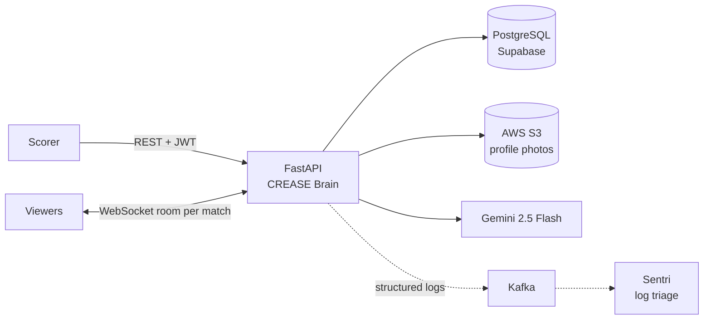

# CREASE Brain

**Backend for CREASE, a live cricket scoring platform for local matches.** A scorer records each ball on their phone, and everyone watching the match sees the scorecard update instantly.

**Live app:** [crease-lens.vercel.app](https://crease-lens.vercel.app)


<!-- Add a screenshot or a short GIF of live scoring here:  -->

## What it does

- **Ball-by-ball scoring.** Toss, squads, innings, overs, deliveries, wickets, and undo of the last ball. Wides and no-balls add runs but do not count as legal balls.
- **Live scorecards over WebSockets.** Each match is a room. After every ball, the backend rebuilds the scorecard and pushes it to every viewer of that match.
- **Teams and players.** Sign up with email or Google, create a team, invite players with a join link, and track career stats and a leaderboard.
- **Profile photos on AWS S3.** Uploads are validated, stripped of location data, resized, and stored with long-lived cache headers.
- **AI scouting and match analysis.** Gemini answers questions about a match or an upcoming fixture, using stats computed from the match database.
- **Central error logging.** Request logs and errors are shipped to Kafka, where [Sentri](https://github.com/GokulAjithV/sentri) triages them.

## Architecture



**One ball, end to end:**

1. The scorer sends `POST /api/matches/innings/{id}/deliver` with a JWT.
2. The backend loads the active over, works out the legal ball number, and saves the delivery.
3. It updates the innings totals and closes the over or innings when complete.
4. It rebuilds the full scorecard and broadcasts it to every WebSocket in that match's room.

## Design decisions

| Decision | Why |
|---|---|
| **Broadcast the full scorecard, not a diff** | A viewer who joins late or reconnects on a weak mobile network gets the correct state from one message. Nothing depends on having seen earlier messages. |
| **Store every delivery, derive everything else** | Scores, strike rates and economy are computed from the `deliveries` table. Undo is then just removing the last row and recomputing. |
| **Photo upload runs as a normal `def` endpoint** | Pillow, boto3 and the Supabase client are blocking. FastAPI runs `def` endpoints in a thread pool, so image work never freezes the event loop that serves WebSockets. |
| **Never trust the upload's content type** | The header is only a cheap first check. Pillow opens the bytes to prove it is a real image, with a pixel limit to block decompression bombs. |
| **Read one byte past the 5 MB limit** | Oversized files are rejected without loading them fully into memory. |
| **A new S3 key for every upload** | Keys are unique, so files can be cached for a year (`immutable`). A new photo gets a new URL, so no cache invalidation is needed. |
| **Delete the S3 file if the database update fails** | S3 and Postgres cannot share a transaction. A compensating delete stops orphaned files from piling up. |
| **Numbers come from code, words come from the model** | Runs, averages and head-to-head stats are calculated in Python and passed to Gemini as context. The model explains the numbers and never has to do arithmetic. |
| **Kafka logging can fail without hurting the API** | It is off by default. When the broker is unreachable, a circuit breaker waits 60 seconds before trying again, and logs fall back to the console. |

## Tech stack

| Area | Tools |
|---|---|
| API | Python, FastAPI, Pydantic, Uvicorn |
| Real time | WebSockets (one room per match) |
| Database | PostgreSQL on Supabase |
| Auth | JWT (HS256), bcrypt password hashing, Google sign-in |
| Storage | AWS S3 (boto3), Pillow for image processing |
| AI | Google Gemini 2.5 Flash, Gemini text embeddings |
| Logging | Apache Kafka (kafka-python), trace ID per request |

## API overview

All routes are under `/api`. Interactive docs are served at `/docs`.

| Area | Endpoints |
|---|---|
| **Auth** | `POST /auth/register`, `POST /auth/login`, `POST /auth/google` |
| **Teams** | Create and list teams, add and remove players, `POST /teams/{id}/invite`, `POST /teams/join/{token}` |
| **Players** | Profiles, search, `GET /players/{id}/stats`, `POST` and `DELETE /players/me/avatar` |
| **Match setup** | `POST /matches`, `/toss`, `/squads`, `/innings/start`, `/over/start` |
| **Scoring** | `POST /matches/innings/{id}/deliver`, `/wicket`, `/undo`, `/end` |
| **Read** | `GET /matches/live`, `/matches/completed`, `/matches/{id}/scorecard`, `/leaderboard` |
| **Live** | `WS /matches/ws/{match_id}` |
| **AI** | `POST /chat/scout`, `POST /chat/predict`, `POST /matches/{id}/analyze` |

## Project structure

```
main.py              App setup, CORS, router registration
routes/              HTTP and WebSocket endpoints (auth, matches, players, teams, chat, leaderboard)
services/
  db.py              Supabase client
  auth.py            Password hashing and JWT
  websocket.py       Per-match connection manager
  image_processing.py  Validate, strip metadata, resize to 512x512 WebP
  storage.py         S3 upload and delete
  kafka_logger.py    Structured logs and request telemetry to Kafka
ai/                  Context building from match data, Gemini calls
models/schemas.py    Pydantic request and response models
```

## Run locally

Requires Python 3.10+.

```bash
git clone https://github.com/GokulAjithV/crease-brain.git
cd crease-brain
python -m venv .venv
source .venv/bin/activate        # Windows: .\.venv\Scripts\Activate.ps1
pip install -r requirements.txt
```

Create a `.env` file:

```env
SUPABASE_URL=
SUPABASE_KEY=
JWT_SECRET_KEY=
GEMINI_API_KEY=

AWS_ACCESS_KEY_ID=
AWS_SECRET_ACCESS_KEY=
AWS_REGION=
S3_BUCKET=
S3_PUBLIC_BASE_URL=

# Optional: ship logs to Kafka (off by default)
KAFKA_ENABLED=false
KAFKA_BOOTSTRAP_SERVERS=localhost:9092
KAFKA_TOPIC=crease-logs
```

Start the server:

```bash
uvicorn main:app --reload --port 8000
```

Open `http://localhost:8000/docs` to try the API.

## Trade-offs and what is next

- **WebSocket rooms live in one process.** This works for a single instance. Running several instances needs a shared channel such as Redis pub/sub, so a ball scored on one instance reaches viewers connected to another.
- **Scoring a ball is several database calls, not one transaction.** The next step is to move each scoring action into a single Postgres function, so a failure halfway cannot leave a partial update.
- **Semantic search is a small JSON file with brute-force comparison.** Fine for a few hundred notes. The plan is pgvector in the existing Postgres database.
- **Automated tests.** Scoring rules (legal balls, over completion, undo) are the first target for a pytest suite.

## Related

- **[Sentri](https://github.com/GokulAjithV/sentri)**: the log triage and root-cause analysis platform that receives CREASE's logs over Kafka.

## Up Next
1. Replacing `opensearch` with `grafana cloud` for log management and analytics 